# 拓展练习 · Task 1 动态图（趋势题）专项

> 这是第 01 课的拓展课件。第 01 课讲的是**怎么描述趋势**，这份课件把同类题型扩展到 6 种常见的动态图，每道都配了题目、解题思路、写作提纲、范文、亮点表达和背诵句。最后还有 2 道只给题目的独立练习，写完发给我批改。
>
> **配图**由 `07_拓展练习_配图/scripts/make_figures.py` 生成，改了数据重新运行即可。所有数据都是**教学用的近似值**，不是真实统计。
>
> **关于 mermaid 图**：文中有两张决策树是用 mermaid 写的，在 GitHub 上能直接显示。VSCode 自带的预览不显示，需要装扩展 *Markdown Preview Mermaid Support*（bierner.markdown-mermaid）。重要的图都另外做成了 PNG，不装扩展也不影响学习。

---

## 目录

- [怎么用这份课件](#怎么用这份课件)
- [第一部分 解题思路](#第一部分-解题思路)
- [第二部分 写作模板](#第二部分-写作模板)
- [第三部分 重点词汇](#第三部分-重点词汇)
- [第四部分 六道真题型练习（带范文）](#第四部分-六道真题型练习带范文)
- [第五部分 独立练习（写完发我批改）](#第五部分-独立练习写完发我批改)
- [第六部分 表达流利度微写作](#第六部分-表达流利度微写作)
- [第七部分 读图陷阱](#第七部分-读图陷阱)
- [附：背诵清单](#附背诵清单)

---

## 怎么用这份课件

**不要从头读到尾。** 先把第一到第三部分过一遍（约 30 分钟），之后每天做一道题。

每道题都按这个顺序来：

1. 只看**题目和原图**，自己做「写前四问」，在纸上列提纲（5 分钟）。
2. 打开「解题思路」对照提纲，看自己漏了哪些特征。
3. **自己写**，限时 20 分钟。
4. 打开「范文」对照，把**亮点表达**抄进自己的句子本。
5. 背 2–3 句**背诵句**。这些句子也已经放进 `09_练习导入.md`，可以推到手机上练。

**建议的两周计划**

| 天 | 内容 | 用时 |
|---|---|---|
| 第 1 天 | 第一到第三部分，熟悉方法 + 词汇图 | 30 分钟 |
| 第 2 天 | Case 1 城乡人口（和作业同型，热身） | 30 分钟 |
| 第 3 天 | Case 2 博物馆（三条线，反超） | 30 分钟 |
| 第 4 天 | 微写作 10 句 + 复习错题集 | 20 分钟 |
| 第 5 天 | Case 3 电动车（带预测，练时态） | 30 分钟 |
| 第 6 天 | Case 4 交通表格（从表格里挑数据） | 30 分钟 |
| 第 7 天 | 背诵：Case 1 和 Case 3 全文 | 20 分钟 |
| 第 8 天 | Case 5 家庭支出（多类别柱状图） | 30 分钟 |
| 第 9 天 | Case 6 用电量（一天 24 小时，钟点介词） | 30 分钟 |
| 第 10 天 | 读图陷阱 + 背诵清单过一遍 | 20 分钟 |
| 第 11–12 天 | **独立练习 Case 7、8，写完发我批改** | 各 25 分钟 |

---

## 第一部分 解题思路

### 1.1 20 分钟流程

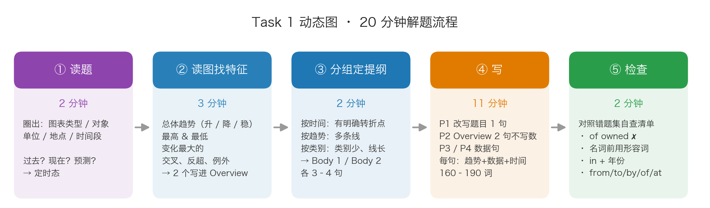

**时间分配的关键**：前 7 分钟不动笔写正文，只做规划。没规划直接写，最常见的结果是写到 Body 2 才发现 Overview 漏了最重要的特征，回头改又来不及。

### 1.2 读题：圈出 5 样东西

拿一道题，先圈出这 5 样：

| 圈什么 | 例子 | 为什么 |
|---|---|---|
| 图表类型 | line graph / bar chart / table | Introduction 第一个词 |
| 对象（测的是什么） | the **percentage** of households / the **number** of visits | 决定主语和单位，百分比和数量用词不同 |
| 单位 | %, thousands, millions, £ | 数据句里每个数都要带单位 |
| 地点 | in England and Wales / in a European city | 改写时不能丢 |
| 时间段 | between 1918 and 2011 / **projected** to 2035 | 决定时态 |

**时态怎么定**

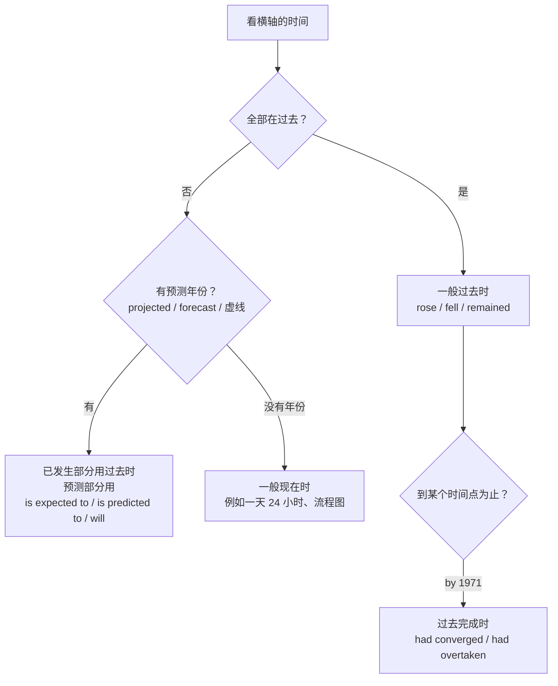

不装 mermaid 扩展的话看这张表也一样：

| 情况 | 时态 | 例句 |
|---|---|---|
| 年份都在过去 | 一般过去时 | Ownership **rose** to 50% in 1971. |
| by + 过去某年 | 过去完成时 | By 1971, the two figures **had converged**. |
| 预测年份 | 将来时 / 被动预测 | The share **is expected to reach** 70% by 2035. |
| 从过去一直延续到现在 | 现在完成时 | Electric cars **have gained** market share. |
| 无具体年份（一天、一般规律） | 一般现在时或过去时均可，**全文统一** | Demand **peaks** at 6 pm. |

### 1.3 找特征：Overview 四问

Overview 是 Task Achievement 的分水岭：**没有 Overview，TA 很难超过 5 分**。写 Overview 前问自己四个问题，挑**最重要的 2–3 个**答案写进去，**不写具体数字**。

| 问题 | 在图上看什么 | Overview 怎么写 |
|---|---|---|
| ① 总体趋势是什么？ | 起点和终点比，升、降还是稳 | Overall, X rose steadily, while Y declined. |
| ② 谁最高，谁最低？ | 全程排名，排名有没有变 | X was by far the most popular throughout the period. |
| ③ 谁变化最大？ | 变化幅度最大的线或类别 | Y saw the most dramatic growth. |
| ④ 有没有交叉、反超或例外？ | 线交叉的位置、唯一一条走势不同的线 | Y overtook X in the 2010s. / Z was the only category that fluctuated. |

### 1.4 分组：Body 1 写什么，Body 2 写什么

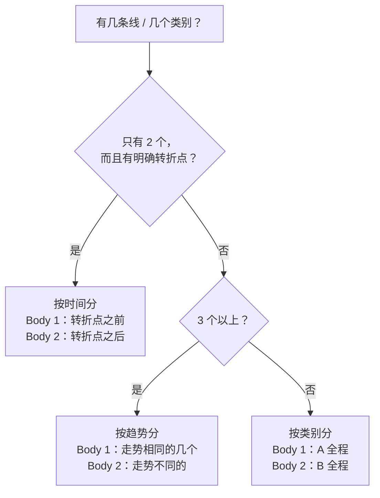

| 分组方法 | 适用 | 本课件里的例子 |
|---|---|---|
| **按时间** | 两条线，中间有一个交叉点或转折点 | 作业题（1971 年持平）、Case 1 |
| **按趋势** | 三条以上的线或类别 | Case 2、Case 3、Case 5 |
| **按类别** | 两条线走势差别很大，按时间分会来回跳 | Case 6（冬季一段，夏季一段） |
| **按数据大小** | 表格，类别多 | Case 4（先写变化大的，再写变化小的） |

---

## 第二部分 写作模板

### 2.1 四段结构

| 段 | 句数 | 词数 | 作用 | 写不写数字 |
|---|---|---|---|---|
| P1 Introduction | 1 | 25–35 | 改写题目 | 不写 |
| P2 Overview | 2 | 35–50 | 2–3 个最重要的特征 | **不写** |
| P3 Body 1 | 3–4 | 50–70 | 第一组数据 | 写，每句 1–3 个 |
| P4 Body 2 | 3–4 | 50–70 | 第二组数据 + 比较 | 写 |
| **合计** | 9–11 | **160–190** | | 不需要写结论段 |

### 2.2 Introduction 改写公式

> **The + 图表类型 + 动词 + 对象 + 地点 + 时间段.**

每个部分都换一个说法：

| 部分 | 题目原文 | 改写 |
|---|---|---|
| 图表类型 | The chart | The bar chart / The line graph / The table |
| 动词 | shows | illustrates / compares / gives information about |
| 对象 | the percentage of | the proportion of / the share of |
| 对象 | the number of | how many / the figures for |
| 对象 | households in owned accommodation | households that owned their homes |
| 时间 | between 1918 and 2011 | over a 93-year period from 1918 to 2011 |
| 时间 | from 2010 to 2020 | over the decade from 2010 to 2020 / over a ten-year period |

✅ The bar chart **compares** the **proportion** of households in England and Wales **that owned or rented their homes** **over a 93-year period from 1918 to 2011**.

### 2.3 Overview 模板句

开头用 **Overall,** / **In general,** / **It is clear that**。

| 功能 | 模板 |
|---|---|
| 两条线一升一降 | Overall, **X rose steadily, while Y declined**. |
| 排名不变 | X remained **by far the most** popular … **throughout the period**. |
| 排名改变 | X **replaced / overtook** Y as the most … |
| 变化最大 | Y **saw the most dramatic growth**. / Y **experienced the most rapid rise in proportional terms**. |
| 唯一的例外 | Z was **the only** category **that** fluctuated / remained stable. |
| 预测 | **This trend is expected to continue** over the next decade. |
| 转折点 | …, **with the turning point coming in** the 1990s. |

### 2.4 Body 句型库（按场景）

**每个数据句 = 趋势 + 数据 + 时间。** 少一样，考官就会认为描述不准确。

| 场景 | 句型 | 例句 |
|---|---|---|
| 起点 + 对比 | In + 年份, X stood at …, compared with … for Y. | In 1950, the urban figure **stood at** 18%, **compared with** 82% **for** rural areas. |
| 起点 + 倍数 | …, roughly twice as many as … | Thailand received 10 million tourists, **roughly twice as many as** Egypt. |
| 上升 | X rose / increased / climbed + 副词 + to … | Visits **rose steadily to** 380,000 in 2016. |
| 上升（名词） | There was a + 形容词 + rise **in** X, **to** … | There was a **sharp rise in** metro use, **to** 165 million. |
| 下降 | X fell / declined / dropped + 副词 + to / by … | Bus journeys **fell steadily to** 80 million. |
| 顶点 | X peaked **at** … in … / reached a peak **of** … | Demand **peaked at** 45 GW **at** 6 pm. |
| 低点 | X hit a low **of** … / fell to a low **of** … | It **fell to a low of** 26 GW at 3 am. |
| 不变 | X remained stable / unchanged **at** around … | Taxi use **remained broadly stable at** around 30 million. |
| 波动 | X fluctuated **between** … **and** … | Art Museum visits **fluctuated between** 390,000 **and** 450,000. |
| 反超 | X overtook Y in … / X had overtaken Y by … | The metro **had overtaken** the bus **by** 2010. |
| 持平 | The two figures converged / were equal in … | **By** 1971, **the two figures had converged** at 50%. |
| 先…后… | X rose to … before falling back to … | It **rose to** 69% **before falling back to** 64%. |
| 接着上句 | This trend continued … / Over the following decade, … | **This trend continued** over the next two decades. |
| 预测 | X is expected / predicted / projected to + 动词 … by … | Country B's share **is expected to** more than triple to 70% **by** 2035. |
| 对比转折 | X, by contrast, … / In contrast, … / Meanwhile, … | **By contrast**, the History Museum declined gradually. |
| 倍数结尾 | …, almost two and a half times the figure for … | …71%, **almost two and a half times the rural figure** of 29%. |

---

## 第三部分 重点词汇

### 3.1 看形状选词

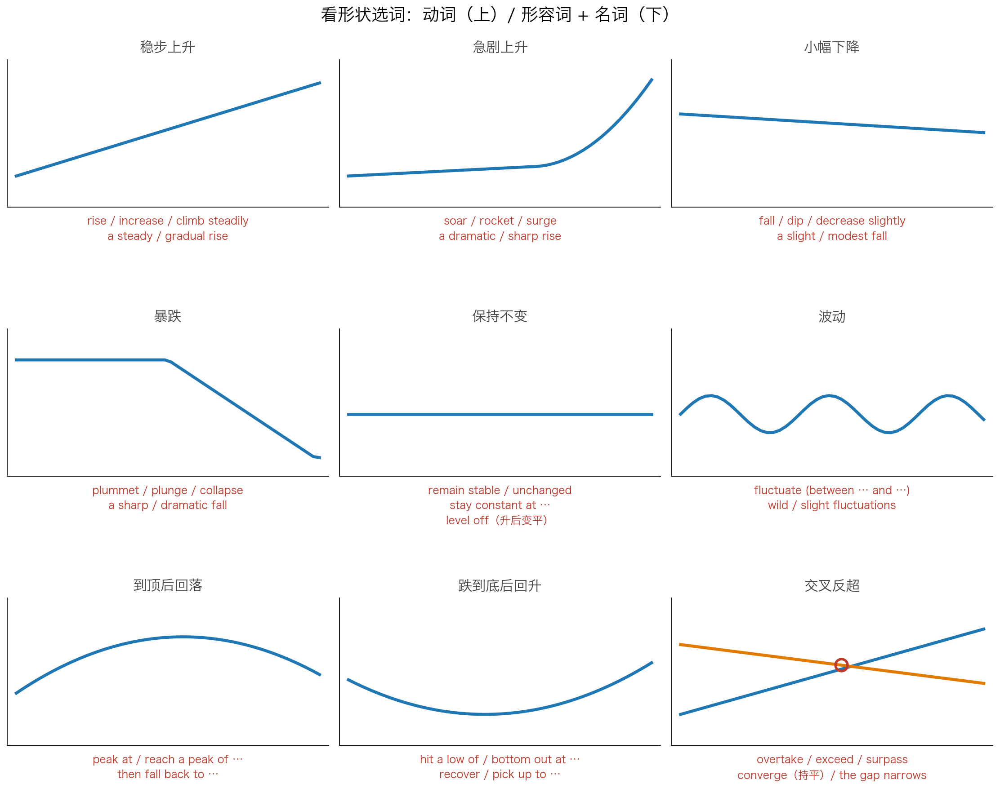

### 3.2 程度阶梯：从小到大

记成对（形容词 → 副词）。名词前用形容词，动词后用副词（错题集 #004）。

| 程度 | 形容词（修饰 rise / fall） | 副词（修饰 rose / fell） |
|---|---|---|
| 极小 | marginal, negligible | marginally |
| 小 | slight, modest, small | slightly, modestly |
| 中 | moderate, steady, gradual | moderately, steadily, gradually |
| 大 | significant, considerable, substantial, marked | significantly, considerably, substantially, markedly |
| 极大 / 快 | dramatic, sharp, steep, rapid | dramatically, sharply, steeply, rapidly |

⚠️ dramatic → dramatic**ally**，没有 dramatical（错题集 #012）。stable 只能用在 remain stable 里，不能修饰 increase（#001）。

### 3.3 数据怎么说

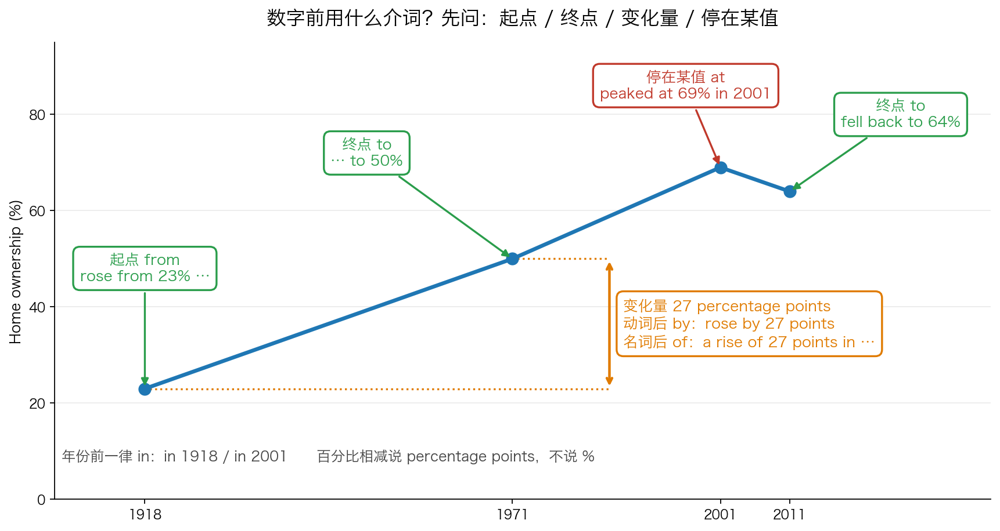

**近似值**（从图上读出的数都要加，错题集 #010）

| 比实际略多 | 约等于 | 比实际略少 |
|---|---|---|
| just over, slightly more than, a little above | around, about, approximately, roughly | just under, almost, nearly, slightly less than |

**分数和倍数**（同义替换百分比，加 Lexical Resource 分）

| 百分比 | 说法 |
|---|---|
| 25% | a quarter |
| 33% | a third / one in three |
| 50% | half |
| 66% | two thirds |
| 75% | three quarters |
| 80% | four in five / the vast majority |
| ×2 | doubled / twice as high as / a twofold increase |
| ×3 | tripled / three times the figure for |
| ÷2 | halved / half the figure for |

### 3.4 时间表达

| 用途 | 表达 |
|---|---|
| 年份、年代 | **in** 1918, **in** the 1990s, **in** the early / late 1990s |
| 钟点 | **at** 3 am, **at** 6 pm, **at** midnight, **at** noon |
| 时间段 | between 1990 and 2000, from 2010 to 2020, over the period, during the decade |
| 到某时为止 | **by** 1971, **by** the end of the period |
| 之后 | the following year, over the next decade, in the subsequent years, thereafter |
| 全程 | throughout the period, over the whole period |
| 交叉点不在刻度上 | some time between 1990 and 2000, shortly after 2016 |
| 一天之内 | in the early hours of the morning, in the mid-afternoon, in the evening |

### 3.5 主语同义替换

同一个主语全文要写 8–10 次，一直重复同一个说法会扣 Lexical Resource 的分。

| 原词 | 替换 |
|---|---|
| the percentage of people living in cities | the urban population / the urban share / urban residents / city dwellers |
| the number of visits to the museum | museum visits / visitor numbers / the museum's figures / attendance |
| electric cars as a percentage of new car sales | the share of electric vehicles / EV sales / the proportion of electric cars |
| the number of journeys by bus | bus journeys / bus use / bus ridership / the number of bus passengers |
| the percentage of income spent on food | spending on food / food expenditure / the share devoted to food |
| electricity demand | demand / electricity consumption / power usage |

### 3.6 连接和对比

| 功能 | 词 |
|---|---|
| 对比 | while, whereas, by contrast, in contrast, on the other hand |
| 同时 | meanwhile, at the same time, over the same period |
| 相似 | similarly, likewise, followed a similar pattern |
| 让步 | although, despite + 名词, even though |
| 接续 | this trend continued, after that, subsequently |
| 例外 | the only exception was …, apart from … |

---

## 第四部分 六道真题型练习（带范文）

| Case | 图型 | 难度 | 本题新考点 |
|---|---|---|---|
| 1 | 双序列柱状图（镜像） | ★☆☆ | 交叉点不在刻度上；倍数结尾 |
| 2 | 三条线的折线图 | ★★☆ | 按趋势分组；反超；波动 |
| 3 | 带预测的折线图 | ★★☆ | 过去时、完成时、将来时混用 |
| 4 | 动态表格 | ★★☆ | 从 12 个数里挑重点；按变化大小分组 |
| 5 | 多类别柱状图 | ★★★ | 4 个类别 × 3 年；percentage points |
| 6 | 一天 24 小时折线图 | ★★☆ | 钟点介词 at；两条线峰值时间不同 |

---

### Case 1 · 城乡人口（双序列柱状图）★☆☆

和作业完全同型，热身用。

**题目**
> The chart below shows the percentage of the population living in urban and rural areas in Country X between 1950 and 2020.
> Summarise the information by selecting and reporting the main features, and make comparisons where relevant.

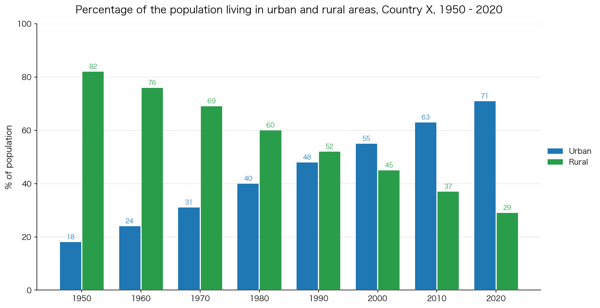

**写前四问**（先自己在纸上答，再展开看）
1. 总体趋势？　2. 谁高谁低，排名变了吗？　3. 转折点在哪？　4. 按什么分组？

解题思路（写完提纲再看）

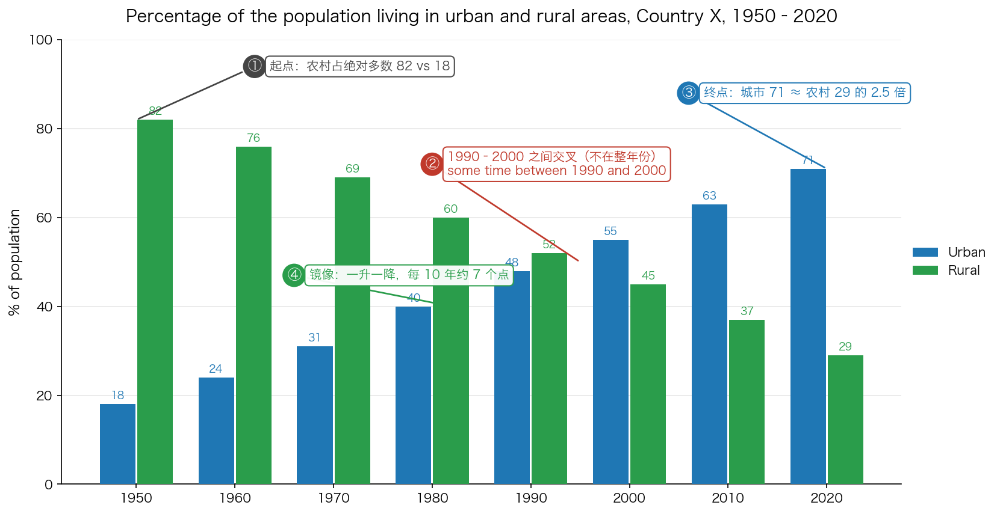

- **趋势**：城市一路升（18 → 71），农村一路降（82 → 29），两者相加 = 100%，是**镜像**。
- **转折点**：1990 年城市 48 < 农村 52，2000 年城市 55 > 农村 45，所以交叉发生在 **1990 到 2000 年之间**。图上没有这一年，**不能编一个年份**，要写 *some time between 1990 and 2000*。
- **分组**：两条线 + 一个转折点 → **按时间分**。Body 1：1950–1990，农村占多数；Body 2：1990–2020，城市反超。
- **和作业的区别**：作业最后十年有回落，这题没有，Overview 里不用写 reversal。

**提纲**

| 段 | 内容 |
|---|---|
| P1 | 改写：bar chart / compares / proportions of people living in … / over a 70-year period |
| P2 | ① 人口持续从农村流向城市　② 农村起初占绝大多数，结束时被城市超过，转折在 1990s |
| P3 | 1950：18 vs 82 → 每十年城市约 +7.5 → 1990：48 vs 52 |
| P4 | 1990–2000 交叉 → 2000：55 → 2020：71，约为农村 29 的 2.5 倍 |

范文（185 words，自己写完再看）

The bar chart compares the proportions of people living in urban and rural areas of Country X over a 70-year period from 1950 to 2020.

Overall, there was a steady shift of the population from the countryside to towns and cities. Rural residents made up the vast majority at the start of the period, but they had been outnumbered by urban dwellers by the end, with the turning point coming in the 1990s.

In 1950, only 18% of the population lived in urban areas, compared with 82% in rural areas. Over the next four decades, the urban share rose steadily by roughly seven or eight percentage points every ten years, reaching 48% in 1990, while the rural figure fell by the same amount to 52%.

Some time between 1990 and 2000, the two figures crossed, and urban residents overtook rural residents for the first time, accounting for 55% of the population in 2000. This trend continued over the following two decades. By 2020, the proportion of people living in cities had climbed to 71%, almost two and a half times the rural figure of 29%.

**亮点表达**

| 表达 | 用法 |
|---|---|
| a steady shift of the population from … to … | 概括"一升一降"，比 X rose while Y fell 高级 |
| had been outnumbered by … by the end | 过去完成时 + 被动，写结尾状态 |
| with the turning point coming in the 1990s | with + 名词 + -ing，独立主格，补充转折时间 |
| by roughly seven or eight percentage points every ten years | 描述匀速变化 |
| some time between 1990 and 2000 | 交叉点不在刻度上 |
| almost two and a half times the rural figure of 29% | 倍数收尾 |

**背诵句** ⭐
1. Overall, there was a steady shift of the population from the countryside to towns and cities.
2. Some time between 1990 and 2000, the two figures crossed, and urban residents overtook rural residents for the first time.
3. By 2020, the proportion of people living in cities had climbed to 71%, almost two and a half times the rural figure of 29%.

---

### Case 2 · 三家博物馆（三条线的折线图）★★☆

**题目**
> The graph below shows the number of visits to three museums in a European city between 2010 and 2020.
> Summarise the information by selecting and reporting the main features, and make comparisons where relevant.

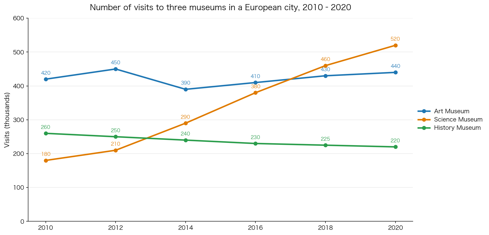

**写前四问**
1. 三条线各是什么走势？　2. 起点和终点的排名分别是？　3. 有没有反超，在什么时候？　4. 三条线怎么分到两个 Body？

解题思路

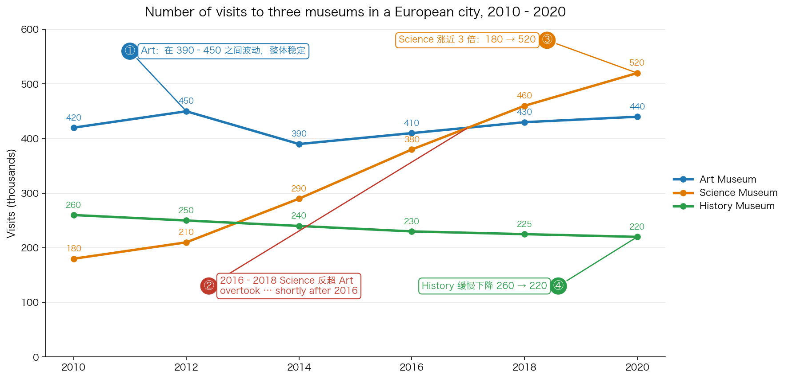

- **三种走势**：Science 大涨（180 → 520，近 3 倍）；Art 波动但整体稳定（390–450）；History 缓慢下降（260 → 220）。
- **排名变化**：开头 Art 第一，Science 最低；结尾 Science 第一。**反超**发生在 2016（380 < 410）到 2018（460 > 430）之间 → *shortly after 2016*。
- **分组**：三条线 → **按趋势分**。Body 1：起点排名 + Art（稳定的那条）；Body 2：Science（大涨）与 History（下降）对比。
- **陷阱**：Art 不是"上升"。420 → 440 只涨了一点，中间还跌到 390，要用 *fluctuated … remained broadly stable*。

范文（162 words）

The line graph illustrates the number of visits to three museums in a European city over the decade from 2010 to 2020.

Overall, the Science Museum saw dramatic growth and had become the most popular of the three by the end of the period, whereas visits to the History Museum declined slightly. The Art Museum, despite some fluctuation, remained broadly stable.

In 2010, the Art Museum was by far the most visited, with 420,000 visits, compared with 260,000 for the History Museum and only 180,000 for the Science Museum. Over the next ten years, the Art Museum's figures fluctuated between 390,000 and 450,000, finishing at 440,000 in 2020.

The Science Museum, by contrast, experienced a steady and substantial rise. Its visitor numbers more than doubled to 380,000 in 2016, and it overtook the Art Museum shortly afterwards, reaching 520,000 in 2020, almost three times its initial figure. Meanwhile, attendance at the History Museum fell gradually throughout the period, from 260,000 to 220,000.

**亮点表达**

| 表达 | 用法 |
|---|---|
| despite some fluctuation, remained broadly stable | 波动但整体不变，despite + 名词 |
| fluctuated between … and …, finishing at … | 波动范围 + 终点 |
| more than doubled to … | 倍数动词 + to 终点 |
| overtook … shortly afterwards | 反超时间不在刻度上 |
| almost three times its initial figure | 和自己的起点比 |
| visits / visitor numbers / attendance / figures | 主语同义替换 |

**背诵句** ⭐
1. The Art Museum, despite some fluctuation, remained broadly stable.
2. Its visitor numbers more than doubled to 380,000 in 2016, and it overtook the Art Museum shortly afterwards.
3. Meanwhile, attendance at the History Museum fell gradually throughout the period, from 260,000 to 220,000.

---

### Case 3 · 电动车销售占比（带预测的折线图）★★☆

**题目**
> The graph below shows electric cars as a percentage of all new car sales in three countries from 2015 to 2025, with projections to 2035.
> Summarise the information by selecting and reporting the main features, and make comparisons where relevant.

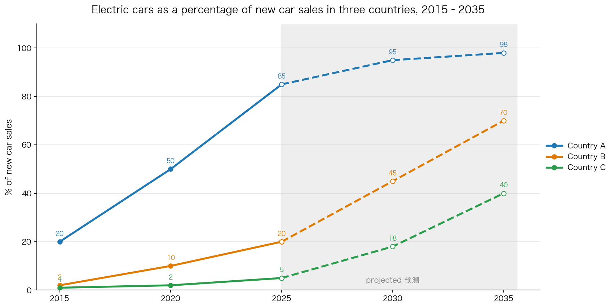

**写前四问**
1. 哪部分是已发生的，哪部分是预测？各用什么时态？　2. 谁一直领先？　3. 未来十年谁涨得最快？　4. 怎么分组？

解题思路

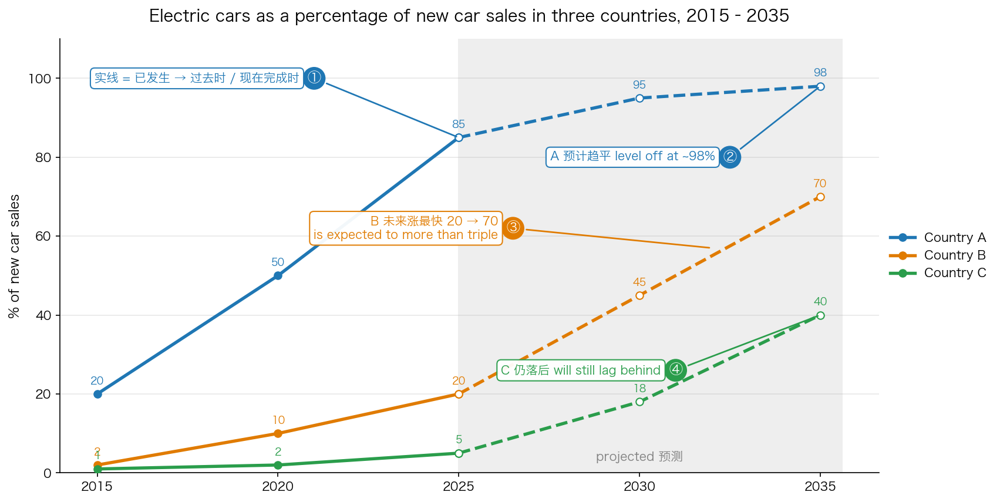

- **时态是这题最大的考点**：
  - 2015–2025 实线 → 一般过去时（rose / saw）
  - 横跨过去到现在的总结 → 现在完成时（have gained）
  - 2025–2035 虚线 → *is expected / projected / predicted / forecast to* + 动词原形，或 *will*
- **特征**：A 一直领先，预计在 98% 左右趋平；B 未来增长最快（20 → 70，三倍多）；C 起点最低，到 2035 仍落后。
- **分组**：**按时间分**，因为时态正好切成两段。Body 1：2015–2025 已发生；Body 2：2025–2035 预测。
- **预测动词别重复**：is expected to / is projected to / is predicted to / is forecast to / will，五个轮换。

范文（178 words）

The line graph shows the percentage of new cars sold that were electric in three countries between 2015 and 2025, along with projections up to 2035.

Overall, electric cars have gained market share in all three countries, and this trend is expected to continue. Country A has led throughout and is predicted to approach 100%, while the most dramatic growth in the coming decade is forecast for Countries B and C.

In 2015, electric vehicles made up 20% of new car sales in Country A, but only 2% and 1% in Countries B and C respectively. Over the next ten years, the figure for Country A rose sharply to 85%, whereas Country B saw a more modest increase to 20%, and Country C remained below 5%.

Looking ahead, Country A's share is projected to level off at around 98% by 2035. In contrast, Country B is expected to see the steepest rise, more than tripling to 70%. Country C is also forecast to grow rapidly, reaching 40%, although it will still lag well behind the other two countries.

**亮点表达**

| 表达 | 用法 |
|---|---|
| along with projections up to 2035 | Introduction 里交代有预测 |
| have gained market share / has led throughout | 现在完成时，从过去延续到现在 |
| … respectively | 一句里给多个对象配多个数字 |
| Looking ahead, … | Body 2 开头，切到预测部分 |
| is projected to level off at around … | 预测 + 趋平 |
| more than tripling to 70% | 分词结构补充数据 |
| will still lag well behind | 预测句的结尾比较 |

**背诵句** ⭐
1. Overall, electric cars have gained market share in all three countries, and this trend is expected to continue.
2. Looking ahead, Country A's share is projected to level off at around 98% by 2035.
3. In contrast, Country B is expected to see the steepest rise, more than tripling to 70%.

---

### Case 4 · 城市交通（动态表格）★★☆

**题目**
> The table below shows the number of journeys made by four modes of transport in a city in 2000, 2010 and 2020 (millions).
> Summarise the information by selecting and reporting the main features, and make comparisons where relevant.

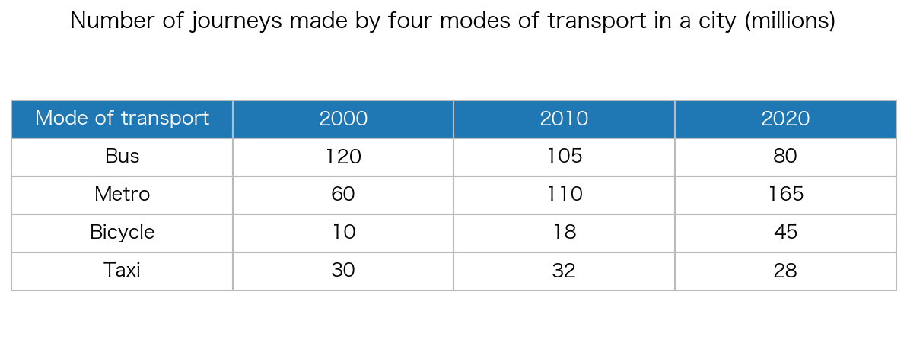

**写前四问**
1. 12 个数字里哪几个最重要？　2. 哪种交通方式变化最大（按绝对值和按比例分别看）？　3. 有没有排名变化？　4. 怎么分组？

解题思路

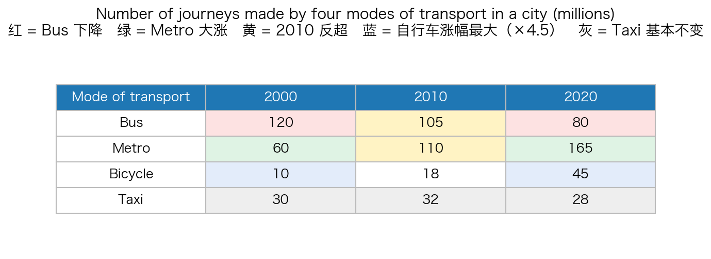

- **表格题的难点是取舍**：不能把 12 个数逐个念一遍。每种交通方式只写**起点、终点**，有转折再加中间值。
- **按变化分组**：
  - Body 1：Bus 和 Metro。两者此消彼长，Metro 在 2010 年反超（110 > 105）。
  - Body 2：Bicycle 和 Taxi。Bicycle 绝对值最小，但**按比例**涨得最多（10 → 45，×4.5）；Taxi 基本不变。
- **"按比例"这个视角**是 7 分以上的标志：*in proportional terms* / *in relative terms*。
- 表格题用 **table** 开头，不要写 *the graph*。

范文（161 words）

The table compares the number of journeys made by bus, metro, bicycle and taxi in a city in 2000, 2010 and 2020.

Overall, the metro replaced the bus as the most popular mode of transport, and cycling grew substantially, whereas taxi use changed very little over the period.

In 2000, buses carried 120 million passengers, twice as many as the metro (60 million). However, bus journeys fell steadily over the next two decades, dropping to 80 million in 2020. Over the same period, metro use rose dramatically, almost doubling to 110 million in 2010, by which time it had overtaken the bus. By 2020, the figure had reached 165 million, more than twice that for buses.

Although cycling accounted for the smallest number of journeys, it saw the most rapid growth in proportional terms, increasing from just 10 million to 45 million, a more than fourfold rise. Taxi journeys, by contrast, remained broadly stable at around 30 million throughout the period.

**亮点表达**

| 表达 | 用法 |
|---|---|
| replaced the bus as the most popular mode of transport | 写排名变化，比 overtook 更完整 |
| …, by which time it had overtaken the bus | 非限制性定语从句 + 过去完成时 |
| more than twice that for buses | that for 代替 the figure for |
| in proportional terms | 按比例看 |
| a more than fourfold rise | 倍数名词 |
| Although X accounted for the smallest …, it saw the most rapid growth | 让步对比句，同时写"最少"和"最快" |

**背诵句** ⭐
1. Overall, the metro replaced the bus as the most popular mode of transport.
2. Metro use rose dramatically, almost doubling to 110 million in 2010, by which time it had overtaken the bus.
3. Although cycling accounted for the smallest number of journeys, it saw the most rapid growth in proportional terms.

---

### Case 5 · 家庭支出（多类别柱状图）★★★

**题目**
> The chart below shows the percentage of household income spent on housing, food, transport and leisure in a country in 1980, 2000 and 2020.
> Summarise the information by selecting and reporting the main features, and make comparisons where relevant.

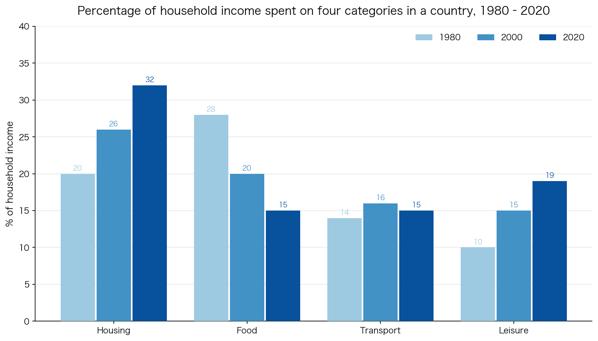

**写前四问**
1. 4 个类别各是什么走势？　2. 1980 年和 2020 年哪项最大？　3. 哪个类别变化最大？　4. 4 个类别怎么分两段？

解题思路

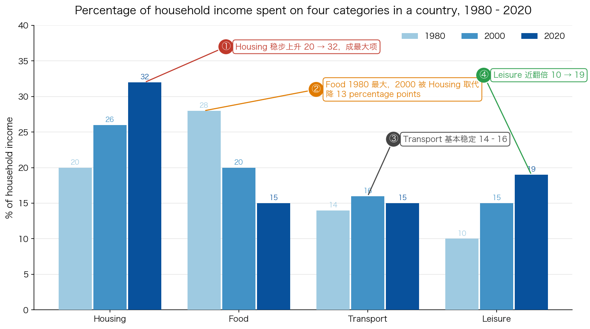

- **按趋势分三类**：上升（Housing、Leisure）、下降（Food）、基本稳定（Transport）。
- **排名变化**：1980 年 Food 最大（28），2000 年起 Housing 最大（26 → 32）。
- **分组**：**按趋势分**。Body 1：两个上升的；Body 2：下降的 + 稳定的。
- **数据考点**：Food 从 28% 降到 15%，是降了 **13 percentage points**，不能说降了 13%（错题集 #008）。
- 横轴是**类别**不是年份，这种图描述的时候还是**按年份讲变化**，不要逐年逐类念数字。

范文（163 words）

The bar chart illustrates the proportion of household income spent on housing, food, transport and leisure in a country in 1980, 2000 and 2020.

Overall, spending on housing and leisure increased considerably, while the share devoted to food fell. Transport costs remained relatively stable. Notably, food, which was the largest expense in 1980, had been replaced by housing by 2000.

In 1980, food accounted for 28% of household spending, compared with 20% for housing. Over the following forty years, the share of income spent on housing rose steadily, reaching 26% in 2000 and 32% in 2020, making it by far the largest category. Leisure followed a similar upward trend, almost doubling from 10% to 19%.

In contrast, the proportion spent on food dropped significantly, falling by 13 percentage points to just 15% by 2020, less than half the figure for housing. Transport, meanwhile, changed only slightly, rising from 14% to 16% in 2000 before returning to 15% at the end of the period.

**亮点表达**

| 表达 | 用法 |
|---|---|
| the share devoted to food | spending on food 的同义替换 |
| Notably, … | Overview 里引出最值得注意的一点 |
| …, making it by far the largest category | 分词结构写结果 |
| followed a similar upward trend | 和上一个类别走势相同 |
| falling by 13 percentage points to just 15% | by 变化量 + to 终点，同一句里 |
| less than half the figure for housing | 分数比较 |

**背诵句** ⭐
1. Notably, food, which was the largest expense in 1980, had been replaced by housing by 2000.
2. Leisure followed a similar upward trend, almost doubling from 10% to 19%.
3. The proportion spent on food dropped significantly, falling by 13 percentage points to just 15% by 2020.

---

### Case 6 · 冬夏用电量（一天 24 小时）★★☆

**题目**
> The graph below shows electricity demand in a country on a typical winter day and a typical summer day.
> Summarise the information by selecting and reporting the main features, and make comparisons where relevant.

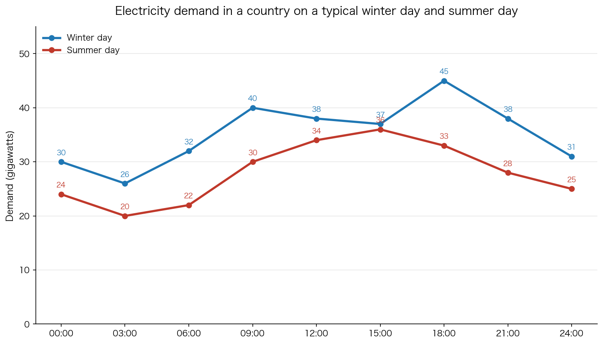

**写前四问**
1. 哪个季节用电多？是不是每个时间点都多？　2. 两条线的最低点和最高点分别在几点？　3. 时间介词用哪个？　4. 怎么分组？

解题思路

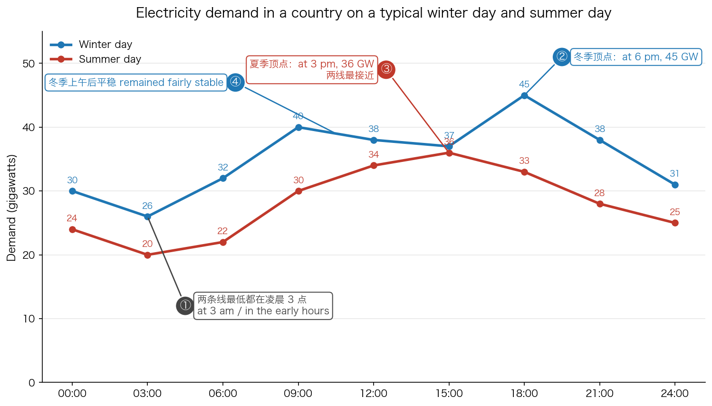

- **新考点：钟点介词**。年份用 in，**钟点用 at**：at 3 am, at 6 pm, at midnight（错题集 #005 的反面）。
- **特征**：冬季几乎全天都高于夏季；两条线最低点都在**凌晨 3 点**；**顶点时间不同**：冬季傍晚 6 点（45 GW），夏季下午 3 点（36 GW）。下午 3 点两条线最接近（37 vs 36）。
- **分组**：两条线形状差别大 → **按类别分**。Body 1：冬季全天；Body 2：夏季全天 + 和冬季比较。
- **时态**：典型的一天，没有具体年份。用一般过去时或一般现在时都可以，**全文统一**。范文用过去时。

范文（186 words）

The line graph compares electricity demand in a country over a 24-hour period on a typical winter day and a typical summer day.

Overall, more electricity was used in winter than in summer at almost every time of day. Demand in both seasons was lowest in the early hours of the morning, but it peaked at different times: in the evening in winter and in the mid-afternoon in summer.

On the winter day, demand stood at 30 gigawatts at midnight and fell to a low of 26 GW at 3 am. It then rose sharply to 40 GW by 9 am and remained fairly stable until 3 pm, before climbing to a daily peak of 45 GW at 6 pm. After that, it declined steadily, returning to 31 GW by midnight.

Summer demand followed a similar pattern in the early morning, dropping to 20 GW at 3 am. However, unlike in winter, it continued to rise throughout the middle of the day, peaking at 36 GW at 3 pm, when it came closest to the winter figure. It then fell back to 25 GW by midnight.

**亮点表达**

| 表达 | 用法 |
|---|---|
| at almost every time of day | 修饰 Overview 的比较，准确 |
| peaked at different times: … and … | 冒号引出两个并列信息 |
| fell to a low of … at 3 am | 低点 + 钟点 |
| remained fairly stable until …, before climbing to … | until + before -ing，一句写两段走势 |
| unlike in winter, … | 引出差异 |
| when it came closest to the winter figure | 关系副词 when，写两线最接近 |

**背诵句** ⭐
1. Demand in both seasons was lowest in the early hours of the morning, but it peaked at different times.
2. It then rose sharply to 40 GW by 9 am and remained fairly stable until 3 pm, before climbing to a daily peak of 45 GW at 6 pm.
3. However, unlike in winter, it continued to rise throughout the middle of the day, peaking at 36 GW at 3 pm.

---

## 第五部分 独立练习（写完发我批改）

这两道**不给范文**。按第一部分的流程自己做：写前四问 → 提纲 → 20 分钟写完 → 对照错题集自查清单 → 发给我批改。

### Case 7 · 主题公园月客流（两年对比）

> The graph below shows the number of visitors to a theme park each month in 2015 and 2025.
> Summarise the information by selecting and reporting the main features, and make comparisons where relevant.

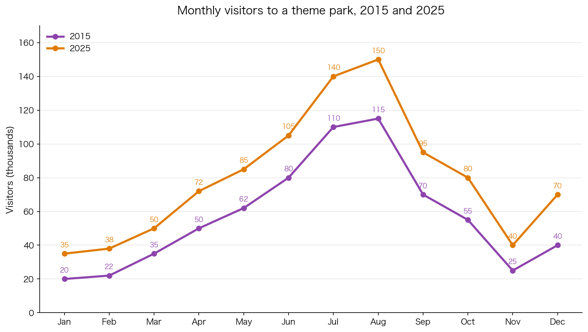

| 月 | Jan | Feb | Mar | Apr | May | Jun | Jul | Aug | Sep | Oct | Nov | Dec |
|---|---|---|---|---|---|---|---|---|---|---|---|---|
| 2015（千人） | 20 | 22 | 35 | 50 | 62 | 80 | 110 | 115 | 70 | 55 | 25 | 40 |
| 2025（千人） | 35 | 38 | 50 | 72 | 85 | 105 | 140 | 150 | 95 | 80 | 40 | 70 |

提示（写完提纲再看）

- 两年的**季节规律**一样：都是夏天（7–8 月）最高、11 月低谷、12 月小反弹。
- 2025 年**每个月**都比 2015 年高，12 月的涨幅最明显（40 → 70）。
- 分组思路：Body 1 写共同的季节规律，Body 2 写两年的差别。
- 用得上的表达：*seasonal pattern*、*a secondary peak in December*、*in every month*、*the summer months*。月份前用 **in**：in July。

### Case 8 · 新闻来源（四条线）

> The graph below shows the percentage of adults in a country who used four different sources for news between 2000 and 2025.
> Summarise the information by selecting and reporting the main features, and make comparisons where relevant.

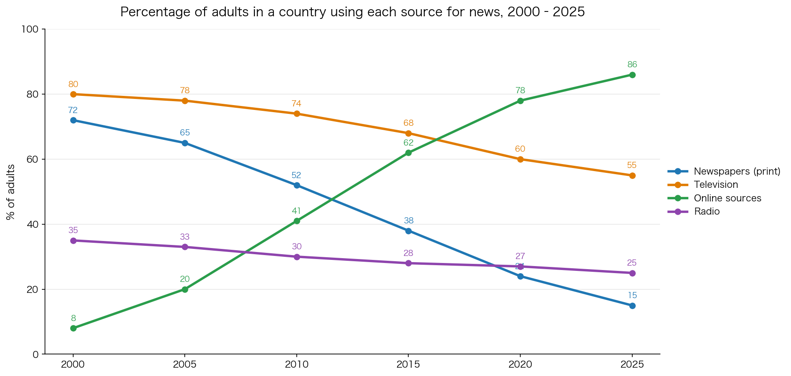

| 年份 | 2000 | 2005 | 2010 | 2015 | 2020 | 2025 |
|---|---|---|---|---|---|---|
| Newspapers (print) % | 72 | 65 | 52 | 38 | 24 | 15 |
| Television % | 80 | 78 | 74 | 68 | 60 | 55 |
| Online sources % | 8 | 20 | 41 | 62 | 78 | 86 |
| Radio % | 35 | 33 | 30 | 28 | 27 | 25 |

提示（写完提纲再看）

- 只有 Online 在涨，其他三个都在降，但**降的速度差很多**：报纸暴跌，电视和广播缓慢下降。
- 有**两次反超**：Online 先超过报纸（2010–2015 之间），后超过电视（2015–2020 之间），最终排第一。
- 同一个人可以用多个来源，所以四个数加起来超过 100%，**不能写"占了总数的多少"**，要写 *X% of adults used …*。
- 分组思路：Body 1 写上升的 Online 和暴跌的 Newspapers（两条线的交叉）；Body 2 写 TV 和 Radio（缓慢下降）以及 Online 超过 TV。

---

## 第六部分 表达流利度微写作

每天写 5 句，每句描述一个变化，**同一个意思写两种**（动词 + 副词 / there was + 形容词 + 名词）。不看句型库，写完再对。

示例：
- 2008 年房价暴跌 40%
  - a) House prices plummeted by 40% in 2008.
  - b) There was a dramatic fall of 40% in house prices in 2008.

练习：
1. 失业率在 2015 到 2019 年之间小幅下降
2. 网购用户数在过去十年飙升
3. 石油价格在 2020 年波动剧烈
4. 出生率自 1990 年以来持续稳步下降
5. 大学入学人数在 2005 年到顶，之后趋于平稳
6. 咖啡消费量翻了一倍
7. 两国的 GDP 在 2012 年持平
8. 这一比例在 90 年代保持在 30% 左右不变
9. 电影票房先升后降
10. 两者的差距在最后五年里缩小了

参考答案（a 动词版 / b 名词版）

1. a) The unemployment rate fell slightly between 2015 and 2019. b) There was a slight fall in the unemployment rate between 2015 and 2019.
2. a) The number of online shoppers soared over the last decade. b) There was a dramatic rise in the number of online shoppers over the last decade.
3. a) Oil prices fluctuated wildly in 2020. b) There were wild fluctuations in oil prices in 2020.
4. a) The birth rate has declined steadily since 1990. b) There has been a steady decline in the birth rate since 1990.
5. a) University enrolments peaked in 2005 and then levelled off. b) University enrolments reached a peak in 2005, after which there was little change.
6. a) Coffee consumption doubled. b) There was a twofold increase in coffee consumption.
7. a) The two countries' GDP figures were equal in 2012. b) The GDP of the two countries converged in 2012.
8. a) The proportion remained unchanged at around 30% throughout the 1990s. b) There was no change in the proportion, which stood at around 30% during the 1990s.
9. a) Cinema takings rose and then fell. b) There was a rise followed by a fall in cinema takings.
10. a) The gap between the two narrowed over the final five years. b) There was a narrowing of the gap between the two in the final five years.

---

## 第七部分 读图陷阱

### 陷阱一：% change 图（课件 Ex.13）

用课件 p.19 的 Dubai 和 Hong Kong 两张图回答：

1. Hong Kong 2012 年的柱子比 2011 年矮，房价是涨了还是跌了？
2. Dubai 2009 年柱子在 0 以下，意味着什么？
3. 如果让你写 Hong Kong 这张图的 Overview，一句话怎么写？

参考

1. **涨了**，只是涨幅比 2011 年小。柱子高度是"涨幅"，不是"价格"。
2. 2009 年房价相比 2008 年**下跌**了（约 45%）。
3. Overall, house prices in Hong Kong rose in every year except 2009, although the annual rate of increase varied considerably and never exceeded 11%.

### 陷阱二到五：本课件里出现过的

| 陷阱 | 出现在 | 错误写法 | 正确处理 |
|---|---|---|---|
| 交叉点不在刻度上 | Case 1、2 | The two lines crossed in 1995. （图上没有 1995） | some time between 1990 and 2000 / shortly after 2016 |
| 小幅波动当成上升 | Case 2 | Art Museum visits increased. | fluctuated … but remained broadly stable |
| 百分比相减说成 % | Case 5 | Food fell by 13%. | fell by 13 percentage points |
| 加起来超过 100% | Case 8 | Online accounted for 86% of news sources. | 86% of adults used online sources |
| 预测部分用过去时 | Case 3 | Country B rose to 70% in 2035. | is expected to rise to 70% by 2035 |

---

## 附：背诵清单

六道题的 18 句背诵句已经放进 [09_练习导入.md](09_练习导入.md) 的「例句：拓展练习 六道题精选句」，Case 1 和 Case 3 全文作为背诵范文也放进去了。推到手机上以后，在「文章 → 推荐 → 课件」里可以看到。

**背诵顺序建议**：先背 Case 1 全文（和作业同型，背熟了作业能直接用上结构），再背 Case 3 全文（时态最全），其余四道只背精选句。

写作前最后 30 秒，读一遍 [错题集](../错题集.md) 里的「写作前自查清单」。
