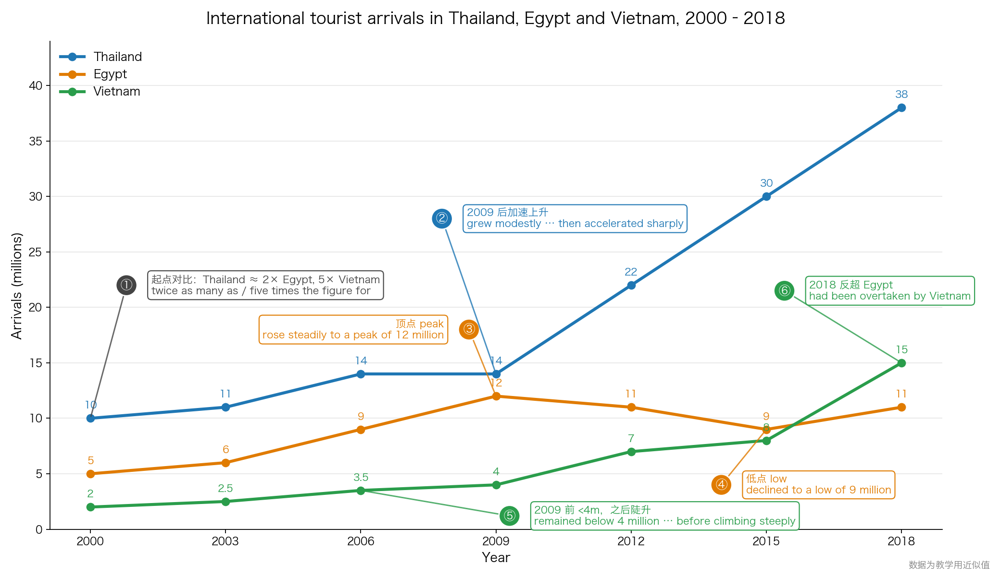
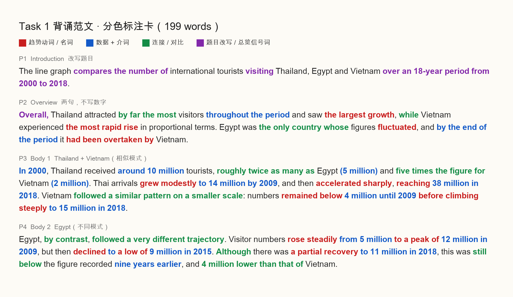
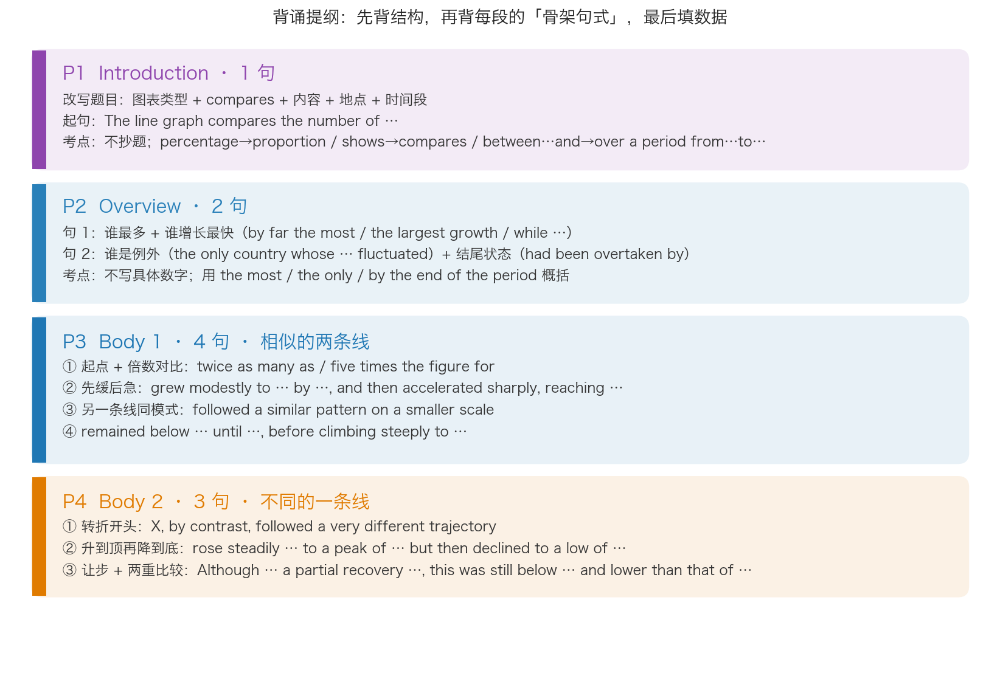

# 背诵范文：折线图 · 三国国际游客人数 2000–2018

和第 01 课同类型（趋势描述），但换成**三条线的折线图**，覆盖了课件里全部四类趋势语言：上升、下降、波动、到顶到底，外加倍数比较和反超。背熟这一篇，作业那种双柱图的句式就都有了。

配图由 `scripts/make_figures.py` 生成，改数据后重跑即可。

---

## 一、题目

> The graph below shows the number of international tourist arrivals in Thailand, Egypt and Vietnam between 2000 and 2018.
>
> Summarise the information by selecting and reporting the main features, and make comparisons where relevant.

| 年份 | Thailand | Egypt | Vietnam |
|---|---|---|---|
| 2000 | 10 | 5 | 2 |
| 2003 | 11 | 6 | 2.5 |
| 2006 | 14 | 9 | 3.5 |
| 2009 | 14 | 12 | 4 |
| 2012 | 22 | 11 | 7 |
| 2015 | 30 | 9 | 8 |
| 2018 | 38 | 11 | 15 |

单位：百万人次。数据为教学用近似值。

## 二、图表与考点

图上 ①–⑥ 六个编号就是范文六个数据句的来源。看图先找这六个点，再开口背。

| 编号 | 图上特征 | 范文里的表达 | 考点 |
|---|---|---|---|
| ① | 2000 年起点，三国差距 | twice as many as / five times the figure for | 倍数比较，一句话放三个数 |
| ② | Thailand 2009 后变陡 | grew modestly … and then accelerated sharply, reaching … | 先缓后急，用 reaching 接数据 |
| ③ | Egypt 2009 顶点 | rose steadily … to a peak of 12 million | peak 用 **to a peak of** |
| ④ | Egypt 2015 低点 | declined to a low of 9 million | low 用 **to a low of** |
| ⑤ | Vietnam 2009 前平、后陡 | remained below … until …, before climbing steeply | until + before -ing |
| ⑥ | 2018 Vietnam 反超 Egypt | had been overtaken by | 过去完成时被动 |

## 三、范文全文（199 words）

The line graph compares the number of international tourists visiting Thailand, Egypt and Vietnam over an 18-year period from 2000 to 2018.

Overall, Thailand attracted by far the most visitors throughout the period and saw the largest growth, while Vietnam experienced the most rapid rise in proportional terms. Egypt was the only country whose figures fluctuated, and by the end of the period it had been overtaken by Vietnam.

In 2000, Thailand received around 10 million tourists, roughly twice as many as Egypt (5 million) and five times the figure for Vietnam (2 million). Thai arrivals grew modestly to 14 million by 2009, and then accelerated sharply, reaching 38 million in 2018. Vietnam followed a similar pattern on a smaller scale: numbers remained below 4 million until 2009 before climbing steeply to 15 million in 2018.

Egypt, by contrast, followed a very different trajectory. Visitor numbers rose steadily from 5 million to a peak of 12 million in 2009, but then declined to a low of 9 million in 2015. Although there was a partial recovery to 11 million in 2018, this was still below the figure recorded nine years earlier, and 4 million lower than that of Vietnam.

## 四、分色背诵卡

红 = 趋势动词/名词，蓝 = 数据和介词，绿 = 连接/对比，紫 = 题目改写和 Overview 信号词。背的时候先背彩色部分，黑色的词是自然填进去的。

## 五、逐段讲解：考点 · 注意 · 关键表达

### P1 Introduction

| | 内容 |
|---|---|
| **考点** | 改写题目，一句话。shows → compares；the number of … arrivals in → the number of … tourists visiting；between 2000 and 2018 → over an 18-year period from 2000 to 2018 |
| **注意** | "18-year" 是形容词，用连字符且 year 不加 s。✗ an 18 years period |
| **关键表达** | `compares the number of … visiting …` · `over an N-year period from … to …` |

### P2 Overview

| | 内容 |
|---|---|
| **考点** | 两句话概括三条线，**不出现任何数字**。句 1 说谁最多、谁涨最快；句 2 说谁是例外、结尾发生了什么 |
| **注意** | `by far the most` 比 `the most` 强，表示"遥遥领先"；`in proportional terms` 说明 Vietnam 是"按比例"涨最快（从 2 到 15 是 7.5 倍），不是绝对量最大，这个限定让表述准确。`had been overtaken` 过去完成时被动，表示"到期末时已经被超过" |
| **关键表达** | `Overall, …` · `by far the most` · `saw the largest growth` · `the most rapid rise` · `the only country whose … fluctuated` · `by the end of the period` · `had been overtaken by` |

### P3 Body 1（相似的两条线放一段）

| | 内容 |
|---|---|
| **考点** | 把模式相似的 Thailand 和 Vietnam 放一段，用 `followed a similar pattern on a smaller scale` 一句话过渡，省掉重复描述。这是"分组"的典型做法 |
| **注意** | 倍数：`twice as many as` 后面直接接比较对象；`five times the figure for` 后接国家名。两种倍数写法交替用。`grew modestly to 14 million by 2009` 里 **to** 是终点、**by** 是时间点，不是幅度。`reaching 38 million` 分词短语接数据，不用再起一句 |
| **关键表达** | `received around … million` · `roughly twice as many as` · `five times the figure for` · `grew modestly to … by …` · `accelerated sharply, reaching …` · `followed a similar pattern on a smaller scale` · `remained below … until …` · `before climbing steeply to …` |

### P4 Body 2（不同的一条线单独一段）

| | 内容 |
|---|---|
| **考点** | 波动的那条线单独成段，开头用 `by contrast` 明确和上一段对比。一条线从升到顶、降到底、再部分回升，三个动作压进两句 |
| **注意** | `rose steadily from 5 million to a peak of 12 million`：from…to… 中间嵌入 a peak of，比单独写 "peaked at 12 million" 省一句。`declined to a low of` 同理。最后一句是**让步 + 两重比较**：Although 回升，但 still below 自己九年前的值，and lower than Vietnam 的值。`that of Vietnam` 的 that 替代 the figure，避免重复 |
| **关键表达** | `by contrast` · `followed a very different trajectory` · `rose steadily from … to a peak of …` · `declined to a low of …` · `Although there was a partial recovery to …` · `still below the figure recorded N years earlier` · `N million lower than that of …` |

## 六、结构提纲（先背这张图）

## 七、三天背诵计划

| 天 | 做什么 | 检验标准 |
|---|---|---|
| 第 1 天 | 看结构提纲图背四段骨架；看分色卡朗读全文 5 遍；背 P1 + P2 | 合上文件，能默写 P1、P2 |
| 第 2 天 | 复习 P1、P2；背 P3、P4；做下面的**挖空版** | 挖空版全部填对 |
| 第 3 天 | 看**中文提示版**复述全文；最后对照原文改错 | 复述与原文出入不超过 5 处 |
| 第 7 天 | 只看图表，不看任何文字，20 分钟内重写一遍 | 字数 150+，六个考点都写到 |

## 八、挖空默写版（第 2 天用）

The line graph ________ the number of international tourists ________ Thailand, Egypt and Vietnam ________ an 18-year period ________ 2000 ________ 2018.

________, Thailand attracted ________ the most visitors ________ the period and saw ________, ________ Vietnam experienced ________ in proportional terms. Egypt was ________ whose figures ________, and ________ the period it ________ Vietnam.

________ 2000, Thailand received ________ 10 million tourists, roughly ________ Egypt (5 million) and ________ Vietnam (2 million). Thai arrivals ________ to 14 million ________ 2009, and then ________, ________ 38 million in 2018. Vietnam ________ on a smaller scale: numbers ________ 4 million ________ 2009 ________ steeply to 15 million in 2018.

Egypt, ________, followed ________. Visitor numbers ________ from 5 million ________ 12 million in 2009, but then ________ 9 million in 2015. ________ there was ________ to 11 million in 2018, this was ________ the figure recorded nine years earlier, and 4 million ________ Vietnam.

答案（按顺序）

compares · visiting · over · from · to ｜ Overall · by far · throughout · the largest growth · while · the most rapid rise · the only country · fluctuated · by the end of · had been overtaken by ｜ In · around · twice as many as · five times the figure for · grew modestly · by · accelerated sharply · reaching · followed a similar pattern · remained below · until · before climbing ｜ by contrast · a very different trajectory · rose steadily · to a peak of · declined to a low of · Although · a partial recovery · still below · lower than that of

## 九、中文提示版（第 3 天用：看中文说英文）

**P1** 折线图比较了 2000 到 2018 这 18 年间到访泰国、埃及、越南的国际游客人数。

**P2** 总体上，泰国全程游客最多且增量最大，而越南按比例涨得最快。埃及是唯一波动的国家，到期末已被越南超过。

**P3** 2000 年泰国接待约 1000 万游客，大约是埃及（500 万）的两倍、越南（200 万）的五倍。泰国到 2009 年小幅增至 1400 万，之后急剧加速，2018 年达 3800 万。越南模式相似但规模较小：2009 年前一直低于 400 万，之后陡升至 2018 年的 1500 万。

**P4** 埃及则走出了完全不同的轨迹。游客数从 500 万稳步升至 2009 年的峰值 1200 万，随后跌至 2015 年的低点 900 万。尽管 2018 年部分回升到 1100 万，但仍低于九年前的数字，并且比越南少 400 万。

## 十、迁移到作业题（England & Wales 住房）

这篇范文里可以直接搬去写作业的句式：

| 范文句式 | 搬到作业里 |
|---|---|
| roughly twice as many as | In 1918, renting households were **more than three times as many as** owners. |
| remained below … until … before climbing | Ownership **remained below a third until 1953 before climbing** to 50% in 1971. |
| rose steadily … to a peak of … in … | Ownership **rose steadily to a peak of** 69% **in** 2001. |
| had been overtaken by | By 1971 renting **had been** caught up by owning; thereafter it **was overtaken**. |
| Although there was a partial recovery … , this was still below … | **Although there was a partial recovery** in renting to 36% in 2011, **this was still** less than half its 1918 level. |
| by contrast / followed a very different trajectory | Renting, **by contrast**, moved in the opposite direction. |
